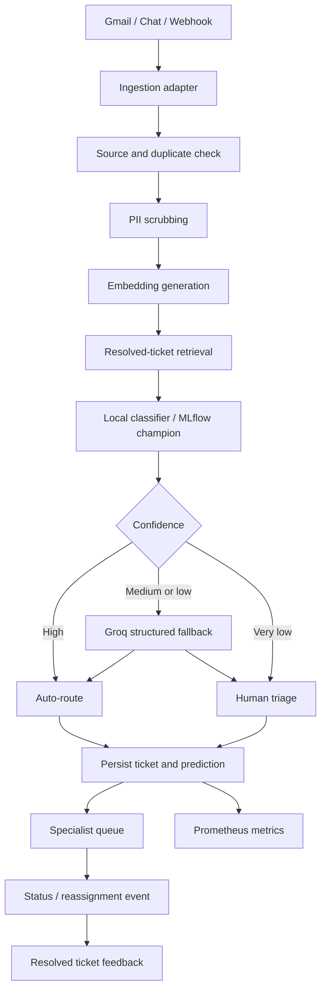
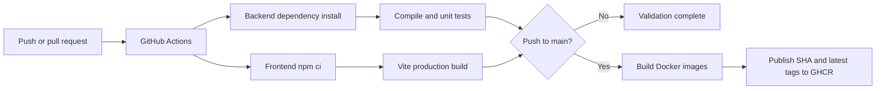

# 6. Complete Project Workflow

## 6.1 Runtime workflow

## 6.2 Detailed routing sequence

1. A message arrives from Gmail, chat, or a webhook.
2. The source ID is checked in memory and, when configured, in Supabase.
3. Duplicate messages return the existing ticket rather than creating a new
   ticket.
4. Subject and content are scrubbed for sensitive values.
5. A 384-dimensional embedding is generated using BGE-small when available.
6. A deterministic hash vector is used if the embedding dependency/model is
   unavailable.
7. Similar resolved tickets can be retrieved through pgvector.
8. The local classifier or MLflow champion predicts the intent.
9. Explicit known keyword signals preserve deterministic routes for known
   intent patterns.
10. Confidence thresholds select automatic routing, LLM fallback, or human
    triage.
11. The ticket, prediction, trace, and embedding are persisted.
12. The frontend receives the ticket through API refresh or WebSocket
    broadcast.

## 6.3 Operator workflow

1. Operator opens the ticket queue.
2. Operator filters by queue, domain, intent, or status.
3. Specialist reviews the scrubbed ticket content.
4. Specialist updates status or reassigns the ticket.
5. The reassignment reason is recorded as an audit event.
6. Resolved tickets become training candidates.

## 6.4 MLOps workflow

1. Prometheus continuously scrapes application metrics.
2. The scheduled drift loop periodically evaluates available data.
3. The service waits until baseline and current samples meet the minimum.
4. Drift results are exposed through the MLOps API and dashboard.
5. Resolved tickets are exported for retraining.
6. A challenger is trained using reassignment weights.
7. Weighted F1 is calculated.
8. The candidate is logged and registered in MLflow.
9. An operator can promote the candidate.
10. The routing service can hot-reload the promoted model.

## 6.5 Delivery workflow

The workflow never reads the local `.env`. Runtime secrets must be supplied
by the deployment environment.
